<a href="https://lat0s.com">
  
</a>

  
  
  
  

## About

I'm George, an **AI Developer and Software Engineer (Full-Stack)** at **RENER Energy S.A.** I build Nexus, the company's **EMS and SCADA platform** for battery energy storage (BESS) and solar PV parks. I work across the backend, the web and mobile apps, and the pipelines that ship them.

Outside RENER I design, build, deploy and run websites and web platforms for businesses in Greece and Cyprus. Nine of them are live below. Most of this work lives in private repositories, so this page describes it instead.

I take features from the ticket to production: design notes and ADRs, code, tests, review, CI/CD, deployment and the on-call fix when an alarm fires at night. I'm finishing an **MSc in Human-Centered AI** at the University of Gothenburg (thesis remaining) and hold a **BSc in Software Engineering and Management** from Chalmers / University of Gothenburg.

## At RENER Energy

**AI Developer · Software Engineer (Full-Stack)** · Aug 2025 to present · remote

- Built the **alarm monitoring system** for the company's energy parks. It opens tickets and sends email, SMS and push alerts, so faults surface **immediately instead of after 3 to 12 days**.
- Led development of the **company mobile app** (Ionic, Capacitor, Android and iOS). Moving alerts from SMS to push notifications **saves about €5,200 a year** in messaging costs.
- Redesigned the **real-time telemetry pipeline** so operators always see current battery data.
- Built **availability and performance analytics** and a **digital twin** that tests changes before they reach real equipment.
- Worked with my manager on database tuning that **cut transaction latency by 40%**.
- Developed **electricity price forecasting**, **RAG systems** over company data and internal AI tools.
- Built and shipped the company website, [renerenergy.gr](https://renerenergy.gr).

`C#` `.NET` `Python` `TypeScript` `React` `PostgreSQL` `Azure DevOps`

## Websites I built and run

Each one is live and maintained. I handled design, development, SEO and deployment for all of them.

<table>
  <tr>
    <td width="33%" valign="top">
      <a href="https://chrysolefou.com">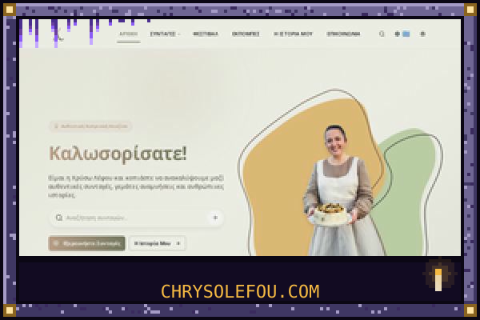</a>
      <b><a href="https://chrysolefou.com">chrysolefou.com</a></b> 
      Recipe platform for a Cypriot TV chef. Semantic recipe search and an AI assistant in the admin. <code>Next.js</code> <code>AI search</code>
    </td>
    <td width="33%" valign="top">
      <a href="https://gmasouras.com">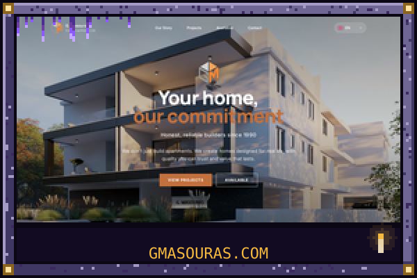</a>
      <b><a href="https://gmasouras.com">gmasouras.com</a></b> 
      Bilingual property platform for a construction firm, with viewing bookings and a custom CMS. <code>React</code> <code>Supabase</code>
    </td>
    <td width="33%" valign="top">
      <a href="https://eoko.gr">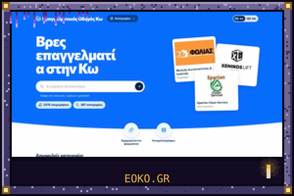</a>
      <b><a href="https://eoko.gr">eoko.gr</a></b> 
      Business directory with 2,000+ listings, AI-assisted imports and an admin CRM. <code>React</code> <code>PostgreSQL</code> <code>Docker</code>
    </td>
  </tr>
  <tr>
    <td width="33%" valign="top">
      <a href="https://www.kaloxoritikakotopoula.com">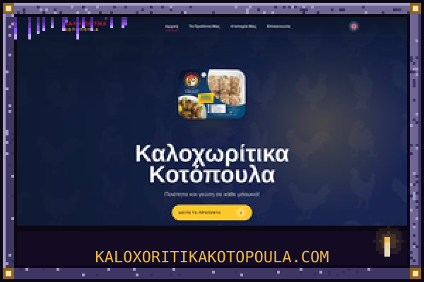</a>
      <b><a href="https://www.kaloxoritikakotopoula.com">kaloxoritikakotopoula.com</a></b> 
      Product site for a poultry producer with a bilingual catalog. <code>Astro</code> <code>React</code>
    </td>
    <td width="33%" valign="top">
      <a href="https://renerenergy.gr">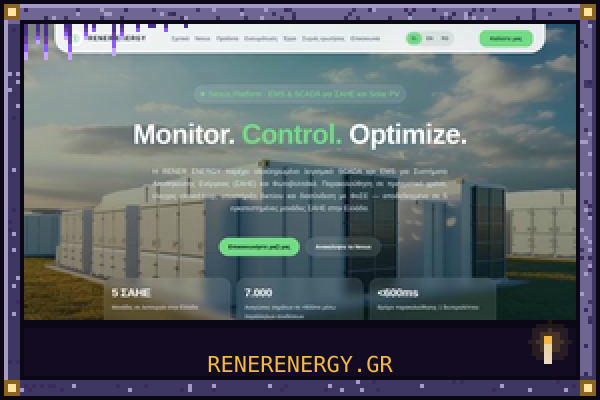</a>
      <b><a href="https://renerenergy.gr">renerenergy.gr</a></b> 
      RENER Energy's company site in three languages, prerendered for SEO. <code>React</code> <code>i18n</code>
    </td>
    <td width="33%" valign="top">
      <a href="https://www.latos.gr">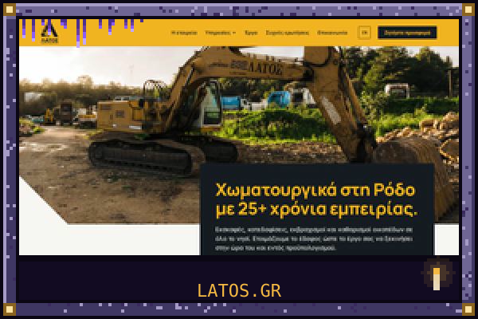</a>
      <b><a href="https://www.latos.gr">latos.gr</a></b> 
      Earthworks and demolition company. Service pages, project gallery and quote requests. <code>Next.js</code> <code>Vercel</code>
    </td>
  </tr>
  <tr>
    <td width="33%" valign="top">
      <a href="https://charalabous.com">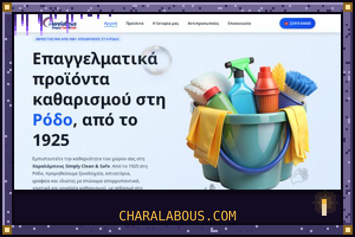</a>
      <b><a href="https://charalabous.com">charalabous.com</a></b> 
      Cleaning supplies distributor. Product catalog with 3D and scroll animation. <code>Next.js</code> <code>Three.js</code>
    </td>
    <td width="33%" valign="top">
      <a href="https://www.exotico.gr">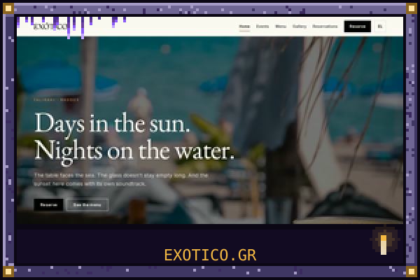</a>
      <b><a href="https://www.exotico.gr">exotico.gr</a></b> 
      Beach bar and restaurant. Menu, events and reservations, covered by end-to-end tests. <code>Next.js</code> <code>Playwright</code>
    </td>
    <td width="33%" valign="top">
      <a href="https://www.sivori.gr">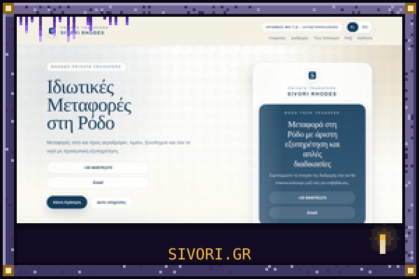</a>
      <b><a href="https://www.sivori.gr">sivori.gr</a></b> 
      Private transfers with booking requests in Greek and English. <code>Astro</code>
    </td>
  </tr>
</table>

## Products and platforms

| Project | What it is | Stack |
| :-- | :-- | :-- |
| [**latos-taskmanager**](https://github.com/lat0s/latos-taskmanager) | Open-source task manager for Linux: per-app CPU, memory, disk and GPU, sensors, startup apps and services. Configurable by an AI agent skill. | `Rust` `React` `TypeScript` |
| [**flossophy**](https://github.com/lat0s/flossophy) · [live demo](https://flossophy.lat0s.com) | Dentist booking app for patients and dentists. Typed end to end, race-safe booking, and a bot-gated demo that sleeps when idle. | `Vue` `Koa` `MongoDB` `TypeScript` |
| **Nexus EMS & SCADA** (RENER, private) | Monitoring and control for battery storage and solar parks, with web and mobile apps for operators. | `C#` `.NET` `React` |
| **Melo** (private, in development) | Restaurant POS and back office: offline-first cashier, kitchen display, handhelds and cloud sync. | `.NET` `React` |
| **eoko** (private) | Multi-site directory platform with vector search and AI-assisted imports. | `React` `PostgreSQL` |
| [**bachelor-thesis**](https://github.com/lat0s/bachelor-thesis) | Measured how AI-generated code affects quality, performance and security in web apps. | `JavaScript` `research` |
| [**GreenThumb**](https://github.com/lat0s/GreenThumb) | University team project, where I was the main contributor: IoT plant monitoring with an Android app. | `Java` `IoT` |

## Skills


- **Languages:** C#, TypeScript, JavaScript, Python, Rust, SQL, Java
- **Backend:** .NET, ASP.NET Core, Node.js, REST APIs, PostgreSQL, event-driven systems
- **Frontend and mobile:** React, Next.js, Angular, Vue, Ionic/Capacitor (Android, iOS)
- **AI:** LLM applications, RAG, vector search, AI agents, forecasting
- **Cloud and DevOps:** Docker, CI/CD (Azure DevOps, GitHub Actions), Linux servers, network security
- **Practice:** system design, code review, testing, Agile, technical SEO

## Infrastructure and delivery


I deploy and run production systems end to end:

- **CI/CD** with automated builds, tests and reviews on every change.
- **Containerized deployments** on cloud and Linux servers I set up and secure myself.
- **Security:** firewalls, private admin access, encrypted secrets and tested backups.
- **Monitoring** with alerts, so problems are fixed before users notice.

## Education

- **MSc Human-Centered Artificial Intelligence**, University of Gothenburg, 2025 to 2027. Coursework done, thesis remaining. Explainable AI, AI law (GDPR, EU AI Act), NLP.
- **BSc Software Engineering and Management**, Chalmers / University of Gothenburg, 2022 to 2025. Software architecture, distributed systems, agile methods.

Greek (native) · English (fluent) · Swedish (conversational)

  

